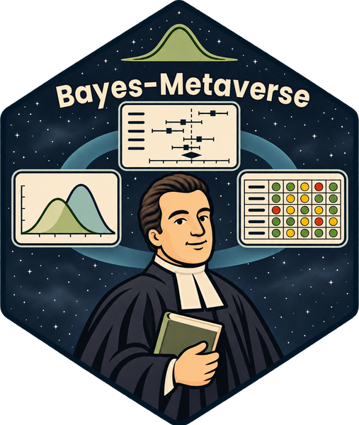
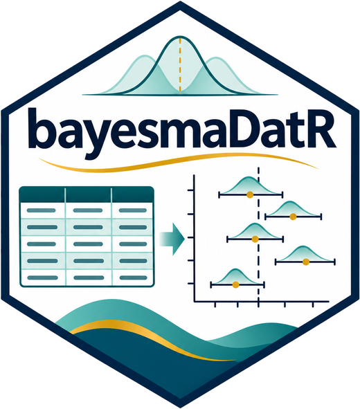
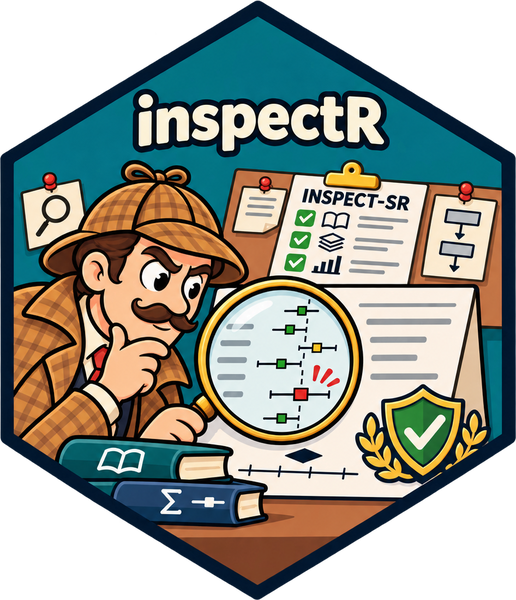
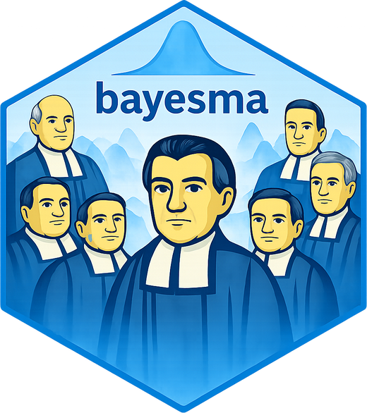
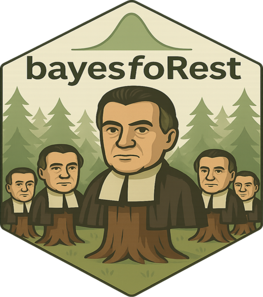

# Bayes-Metaverse <a href="https://bayesian-metaverse.github.io/bayesmetaverse/"></a>

<!-- badges: start -->
[](https://lifecycle.r-lib.org/articles/stages.html#experimental)
[](https://opensource.org/licenses/MIT)
<!-- badges: end -->

***Tools, methods and resources for Bayesian meta-analysis.***

## What is Bayes-Metaverse?

Bayes-Metaverse brings together an R package suite, practical guidance and links to established software to support a transparent, reproducible workflow for Bayesian meta-analysis (Bayesian MA). The aim is to help researchers move from a clearly specified review question through data preparation, model fitting and checking, sensitivity analysis, and interpretation.

The project is organised around a **workflow rather than a single model**. Different reviews need different likelihoods, effect measures, priors and sensitivity analyses; the workflow makes those choices explicit and documents why they were made. See [Getting Started](https://bayesian-metaverse.github.io/bayesmetaverse/articles/bayesmetaverse.html) for the full workflow.

## Package suite

The packages are designed to work together while remaining useful as standalone tools.

<div class="bmv-suite">
<div class="bmv-pkg">
<a class="bmv-hex" href="https://blmoran.github.io/bayesmaDatR/"></a>
<div class="bmv-pkg-text">
<p class="bmv-pkg-desc"><b>bayesmaDatR</b> · Shiny app for structured data extraction and entry, producing analysis-ready meta-analysis data</p>
<p class="bmv-pkg-badges"><a href="https://github.com/BLMoran/bayesmaDatR"></a> <a href="https://blmoran.github.io/bayesmaDatR/"></a> </p>
</div>
</div>
<div class="bmv-pkg">
<a class="bmv-hex" href="https://github.com/BLMoran/inspectR"></a>
<div class="bmv-pkg-text">
<p class="bmv-pkg-desc"><b>inspectR</b> · Assess and document study trustworthiness using the INSPECT-SR framework</p>
<p class="bmv-pkg-badges"><a href="https://github.com/BLMoran/inspectR"></a> </p>
</div>
</div>
<div class="bmv-pkg">
<a class="bmv-hex" href="https://blmoran.github.io/robbR/"></a>
<div class="bmv-pkg-text">
<p class="bmv-pkg-desc"><b>robbR</b> · Create and present risk-of-bias visualisations</p>
<p class="bmv-pkg-badges"><a href="https://github.com/BLMoran/robbR"></a> <a href="https://blmoran.github.io/robbR/"></a> </p>
</div>
</div>
<div class="bmv-pkg">
<a class="bmv-hex" href="https://blmoran.github.io/bayesma/"></a>
<div class="bmv-pkg-text">
<p class="bmv-pkg-desc"><b>bayesma</b> · Fit, check, compare and interpret Bayesian meta-analysis models using Stan</p>
<p class="bmv-pkg-badges"><a href="https://github.com/BLMoran/bayesma"></a> <a href="https://blmoran.github.io/bayesma/"></a> </p>
</div>
</div>
<div class="bmv-pkg">
<a class="bmv-hex" href="https://blmoran.github.io/bayesfoRest/"></a>
<div class="bmv-pkg-text">
<p class="bmv-pkg-desc"><b>bayesfoRest</b> · Forest plots and visualisations that bring posterior results and study-level information together</p>
<p class="bmv-pkg-badges"><a href="https://github.com/BLMoran/bayesfoRest"></a> <a href="https://blmoran.github.io/bayesfoRest/"></a> </p>
</div>
</div>
</div>

A package for **Bayesian sequential meta-analysis** (trial sequential analysis), informed by Spence, Steinsaltz & Fanshawe (2016), is also in development.

## Installation

Install the whole suite with the `bayesmetaverse` meta-package:

```r
install.packages("remotes")
remotes::install_github("bayes-metaverse/bayesmetaverse")
```

Or install individual packages:

```r
remotes::install_github("BLMoran/bayesmaDatR")
remotes::install_github("BLMoran/inspectR")
remotes::install_github("BLMoran/robbR")
remotes::install_github("BLMoran/bayesma")
remotes::install_github("BLMoran/bayesfoRest")
```

`bayesma` uses Stan via [cmdstanr](https://mc-stan.org/cmdstanr/). See the [bayesma installation guide](https://blmoran.github.io/bayesma/) for setting up CmdStan.

## Citation

If you use Bayes-Metaverse, please cite the packages you use and the underlying methods:

```r
citation("bayesmetaverse")
citation("bayesma")
```

```bibtex
@Manual{bayesmetaverse,
  title  = {Bayes-Metaverse: Tools, Methods and Resources for Bayesian Meta-Analysis},
  author = {Benjamin Moran and Thomas Payne},
  year   = {2026},
  note   = {R package version 0.0.0.9000},
  url    = {https://github.com/bayesian-metaverse/bayesmetaverse},
}
```

## Feedback, issues and contribution

- **Bugs and feature requests:** open an issue in the relevant package repository, or in [bayesmetaverse](https://github.com/bayesian-metaverse/bayesmetaverse/issues) if you're not sure which package.
- **Questions and ideas:** use [GitHub Discussions](https://github.com/bayesian-metaverse/bayesmetaverse/discussions).
- **Contributions:** pull requests are welcome. Please read the [contributing guide](.github/CONTRIBUTING.md) first.
- **Code of conduct:** this project follows a [Contributor Code of Conduct](.github/CODE_OF_CONDUCT.md). By participating, you agree to abide by its terms.

## License

Bayes-Metaverse packages are released under the [MIT License](LICENSE.md).

## Acknowledgements

- The [Stan Development Team](https://mc-stan.org/) for Stan, cmdstanr and the wider Stan ecosystem.
- The [INSPECT-SR](https://doi.org/10.1136/bmj-2024-082233) team, whose framework underpins inspectR.
- Spence, Steinsaltz & Fanshawe (2016) for the Bayesian sequential meta-analysis methods.
- The authors of [brms](https://paul-buerkner.github.io/brms/), [bayesmeta](https://cran.r-project.org/package=bayesmeta), [MetaStan](https://cran.r-project.org/package=MetaStan), [RoBMA](https://cran.r-project.org/package=RoBMA) and [scrutiny](https://lhdjung.github.io/scrutiny/), whose work informs and complements this project.
- Inspired by [tidyverse](https://www.tidyverse.org/), [easystats](https://easystats.github.io/easystats/), [fastverse](https://fastverse.org/) and [metaverse](https://rmetaverse.github.io/).
