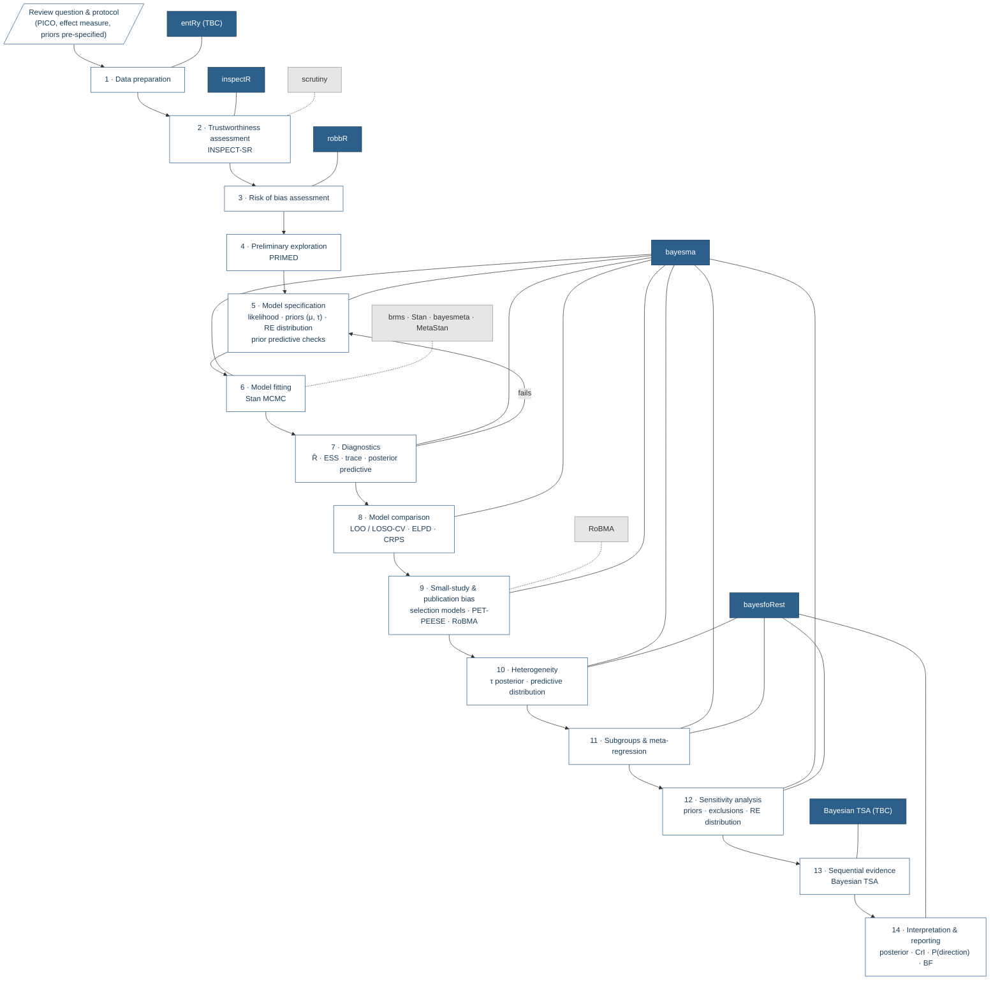

<!-- README for the Bayesian Metaverse website / GitHub organisation profile -->
<!-- Hex paths assume images are stored in man/figures/hex/ — replace with final paths -->

<p align="center">
  
</p>

<h1 align="center">Bayesian Metaverse</h1>

<p align="center"><em>Tools, methods and resources for Bayesian meta-analysis.</em></p>

<p align="center">
  
  
  
  
  
  
</p>

---

## Overview

Bayesian Metaverse brings together an R package suite, practical guidance and links to established software to support a transparent, reproducible workflow for Bayesian meta-analysis (Bayesian MA). The aim is to help researchers move from a clearly specified review question through data preparation, model fitting and checking, sensitivity analysis, and interpretation.

The project is organised around a **workflow rather than a single model**. Different reviews need different likelihoods, effect measures, priors and sensitivity analyses; the workflow makes those choices explicit and documents why they were made. It builds on the [bayesma workflow diagram](https://blmoran.github.io/bayesma/articles/workflow-diagram.html).

---

## The package suite

| Hex | Package | Workflow stage | Purpose | Status |
|:---:|:--------|:---------------|:--------|:-------|
|  | **entRy** *(name TBC)* | Data preparation | Shiny app for structured data extraction and entry (one row per study; binary, continuous or count outcomes), exporting analysis-ready data. | In development · [preview](https://blmoran.github.io/bayesma/articles/data-entry.html) |
|  | **inspectR** | Trustworthiness | Assess and document study trustworthiness using the [INSPECT-SR](https://doi.org/10.1136/bmj-2024-082233) framework. Complements, but does not replace, risk-of-bias assessment. | In development |
|  | **robbR** | Risk of bias | Create and present risk-of-bias visualisations (traffic-light and summary plots). | Available · repository TBA |
|  | **bayesma** | Modelling | Fit, compare, check and interpret Bayesian meta-analysis models in R using Stan. | Available · [docs](https://blmoran.github.io/bayesma/) |
|  | **bayesfoRest** | Visualisation | Forest plots and other displays that bring posterior results and study-level information together. | Available · [docs](https://blmoran.github.io/bayesfoRest/) |
|  | **Bayesian TSA** *(name TBC)* | Sequential evidence | Bayesian sequential assessment of accumulating meta-analytic evidence, informed by Spence, Steinsaltz & Fanshawe (2016). | In development |

The packages are designed to work together while remaining useful as standalone tools.

---

## Installation

Development versions of the available packages can be installed from GitHub:

```r
install.packages("remotes")

remotes::install_github("BLMoran/bayesma")
remotes::install_github("BLMoran/bayesfoRest")
```

<!-- Future: a meta-package that installs and attaches the suite, e.g.
```r
remotes::install_github("bayesian-metaverse/bayesmetaverse")
library(bayesmetaverse)
```
-->

---

## A principled Bayesian meta-analysis workflow

Each stage lists the package(s) you would typically use. Grey nodes are related external software.



> A static version of the diagram (with hexes in place of node labels) can be swapped in once the artwork is final:
> ``

### Stage → package lookup

| Stage | Bayesian Metaverse | Key functions | Related software |
|:------|:-------------------|:--------------|:-----------------|
| Data preparation | entRy *(TBC)* | `launch_data_entry()` | — |
| Trustworthiness | inspectR | `inspect_sr()`, `inspect_sr_table()`, `inspect_sr_plot()`, `filter_trustworthy()` | scrutiny |
| Risk of bias | robbR | `rob_plot()` | — |
| Preliminary exploration | bayesma | `primed()` | — |
| Model specification | bayesma | `bayesma(sample_prior = TRUE)`, `pp_check()` | brms |
| Model fitting | bayesma | `bayesma()` | Stan, brms, bayesmeta, MetaStan |
| Diagnostics | bayesma | `diagnostics()`, `pp_check()` | — |
| Model comparison | bayesma | `compare_models()`, `compare_table()`, `compare_plot()` | — |
| Publication bias | bayesma | `egger()`, `funnel_plot()`, `robma()` | RoBMA |
| Heterogeneity | bayesma, bayesfoRest | `bayesma(re_dist = "mixture")`, `forest()` | bayesmeta |
| Subgroups / meta-regression | bayesma, bayesfoRest | `meta_reg()`, `metareg_mod_plot()`, `forest(subgroup = TRUE)` | brms |
| Sensitivity analysis | bayesma, bayesfoRest | `sensitivity_plot()` | — |
| Sequential evidence | Bayesian TSA *(TBC)* | TBA | — |
| Interpretation & reporting | bayesma, bayesfoRest | `interpret()`, `overall_plot()`, `forest()` | — |

---

## Related software

The Bayesian Metaverse builds on, and is designed to sit alongside, established tools. These packages are maintained independently by their authors and are listed here with permission. <!-- confirm permission before publishing -->

| Hex | Package | Description | Link |
|:---:|:--------|:------------|:-----|
|  | **Stan** | Probabilistic programming language for Bayesian inference; the engine behind bayesma. | [mc-stan.org](https://mc-stan.org/) |
|  | **brms** | Bayesian (multilevel) regression models via Stan using formula syntax; flexible for bespoke meta-analytic models. | [paul-buerkner.github.io/brms](https://paul-buerkner.github.io/brms/) |
|  | **bayesmeta** | Fast, semi-analytical Bayesian random-effects meta-analysis for the normal–normal hierarchical model. | [CRAN](https://cran.r-project.org/package=bayesmeta) |
|  | **MetaStan** | Bayesian meta-analysis via Stan, including binomial–normal models and model-based meta-analysis. | [CRAN](https://cran.r-project.org/package=MetaStan) |
|  | **RoBMA** | Robust Bayesian meta-analysis: Bayesian model averaging over effect, heterogeneity and publication bias models. | [CRAN](https://cran.r-project.org/package=RoBMA) |
|  | **scrutiny** | Error detection in summary statistics (GRIM, GRIMMER, DEBIT); supports trustworthiness checks. | [lhdjung.github.io/scrutiny](https://lhdjung.github.io/scrutiny/) |

---

## Guidance and resources

- **Workflow** — [Bayesian MA workflow diagram](https://blmoran.github.io/bayesma/articles/workflow-diagram.html)
- **Data entry** — [Data entry app](https://blmoran.github.io/bayesma/articles/data-entry.html)
- **Trustworthiness** — INSPECT-SR: Wilkinson J, et al. *BMJ* (2025)
- **Sequential analysis** — Spence GT, Steinsaltz D, Fanshawe TR. A Bayesian approach to sequential meta-analysis. *Stat Med*. 2016;35(29):5356–5375.
- **Further reading** — *(add tutorials, reporting guidelines, e.g. ROBUST/BayesMA reporting checklists)*

---

## Contributing

Contributions, issues and feature requests are welcome. Please open an issue in the relevant package repository, or start a discussion in the [Bayesian Metaverse organisation](https://github.com/bayesian-metaverse).

## Citation

If you use the Bayesian Metaverse packages, please cite the individual packages you use (`citation("bayesma")`) and the underlying methods papers.

## Authors

Benjamin Moran · Thomas Payne · *(add contributors)*

## Licence

*(add licence)*
