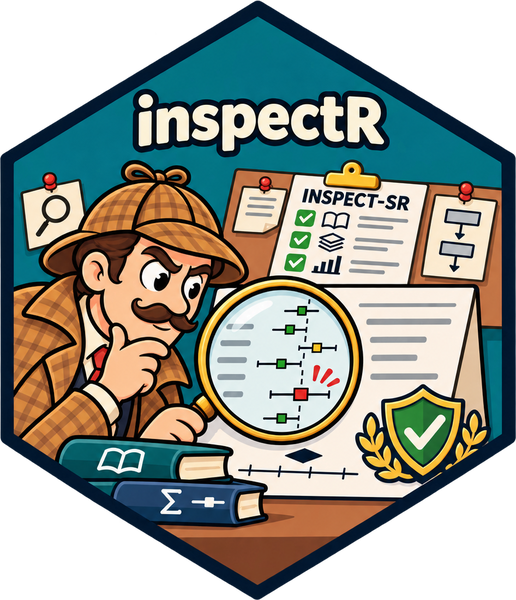

# Getting Started

## A principled Bayesian meta-analysis workflow

This workflow takes you from a review question to a reported result.
Each stage lists the Bayes-Metaverse package(s) to use, the key
functions, and related software.

The stages are listed in order, but the workflow is iterative. If
diagnostics or checks fail, go back and revise the model.

``` r

library(bayesmetaverse)  # attaches bayesmaDatR, inspectR, robbR, bayesma, bayesfoRest
```

→
→ →
→ 

Plan

protocol

### 0 · Review question and protocol

Define the PICO, effect measure, likelihood and primary model.
Pre-specify the priors and sensitivity analyses.

Related: [PROSPERO](https://www.crd.york.ac.uk/prospero/) ·
[OSF](https://osf.io/)

Prepare


### 1 · Data preparation

Extract and enter study data in a structured way, with one row per study
(binary, continuous or count outcomes).

``` r

bayesmaDatR::launch_data_entry()
```


### 2 · Trustworthiness assessment

Assess each study against the four INSPECT-SR domains. Document the
judgements, and decide how to handle studies of concern. This
complements risk-of-bias assessment; it does not replace it.

``` r

tw <- inspectR::inspect_sr(dat)
inspectR::inspect_sr_table(tw)
inspectR::inspect_sr_plot(tw)
dat_tw <- inspectR::filter_trustworthy(dat, tw)
```

Related: [scrutiny](https://lhdjung.github.io/scrutiny/) (GRIM, GRIMMER,
DEBIT checks)


### 3 · Risk of bias assessment

Visualise domain-level risk-of-bias judgements with traffic-light and
summary plots.

``` r

robbR::rob_plot(rob_dat)
```


### 4 · Preliminary exploration

Explore the dependence structure, possible moderators and the
distribution of effect sizes before modelling (PRIMED).

``` r

bayesma::primed(dat)
```

Model


### 5 · Model specification

Choose the likelihood, the random-effects distribution, the priors on μ
and τ, and whether the model is one-stage or two-stage. Check the priors
with prior predictive checks.

``` r

fit_prior <- bayesma::bayesma(dat, sample_prior = TRUE)
bayesma::pp_check(fit_prior)
```

Related: [brms](https://paul-buerkner.github.io/brms/)


### 6 · Model fitting

Fit the model with Stan’s MCMC sampler (by default, 4 chains).

``` r

fit <- bayesma::bayesma(dat, stage = "one_stage")
```

Related: [Stan](https://mc-stan.org/) ·
[brms](https://paul-buerkner.github.io/brms/) ·
[bayesmeta](https://cran.r-project.org/package=bayesmeta) ·
[MetaStan](https://cran.r-project.org/package=MetaStan)


### 7 · Model diagnostics

Check convergence (R̂, ESS, trace plots) and model fit (posterior
predictive checks). If the checks fail, return to stage 5.

``` r

bayesma::diagnostics(fit)
bayesma::pp_check(fit)
```


### 8 · Model comparison

Compare candidate models using LOO or leave-one-study-out
cross-validation (LOSO-CV), ELPD, CRPS and calibration.

``` r

cmp <- bayesma::compare_models(fit, fit_alt)
bayesma::compare_table(cmp)
bayesma::compare_plot(cmp)
```

Check


### 9 · Small-study effects and publication bias

Use funnel plots, Egger-type tests, selection models, PET-PEESE and
robust Bayesian model averaging (RoBMA).

``` r

bayesma::funnel_plot(fit)
bayesma::egger(fit)
bayesma::robma(dat)
```

Related: [RoBMA](https://cran.r-project.org/package=RoBMA)


### 10 · Heterogeneity

Look at the posterior for τ and the predictive distribution for a new
study. Consider robust or mixture random-effects distributions.

``` r

fit_mix <- bayesma::bayesma(dat, re_dist = "mixture")
bayesfoRest::forest(fit)
```


### 11 · Subgroups and meta-regression

Model categorical and continuous moderators.

``` r

mr <- bayesma::meta_reg(dat, moderator = ~ dose)
bayesma::metareg_mod_plot(mr)
bayesfoRest::forest(fit, subgroup = TRUE)
```

Related: [brms](https://paul-buerkner.github.io/brms/)


### 12 · Sensitivity analysis

Vary the priors, the studies included (for example, excluding high
risk-of-bias or untrustworthy studies), the random-effects distribution,
and one-stage versus two-stage models.

``` r

bayesma::sensitivity_plot(fit)
```

in\
development

### 13 · Sequential evidence

Assess the accumulating evidence with a Bayesian sequential approach
(Spence, Steinsaltz & Fanshawe, 2016). The package is in development.

Report


### 14 · Interpretation and reporting

Report the pooled effect with its 95% credible interval, P(direction),
Bayes factors where relevant, the forest plot, MCMC diagnostics and the
sensitivity analyses.

``` r

bayesma::interpret(fit)
bayesma::overall_plot(fit)
bayesfoRest::forest(fit)
```

## Related software

Bayes-Metaverse is designed to sit alongside established tools. These
are maintained independently by their authors.

- [**Stan**](https://mc-stan.org/): probabilistic programming language
  for Bayesian inference
- [**brms**](https://paul-buerkner.github.io/brms/): Bayesian multilevel
  models via Stan using formula syntax
- [**bayesmeta**](https://cran.r-project.org/package=bayesmeta): fast
  semi-analytical Bayesian random-effects meta-analysis
- [**MetaStan**](https://cran.r-project.org/package=MetaStan): Bayesian
  meta-analysis via Stan
- [**RoBMA**](https://cran.r-project.org/package=RoBMA): robust Bayesian
  meta-analysis via model averaging
- [**scrutiny**](https://lhdjung.github.io/scrutiny/): error detection
  in summary statistics

## References

- Spence GT, Steinsaltz D, Fanshawe TR. A Bayesian approach to
  sequential meta-analysis. *Statistics in Medicine*.
  2016;35(29):5356–5375.
- INSPECT-SR: *(add full reference)*
